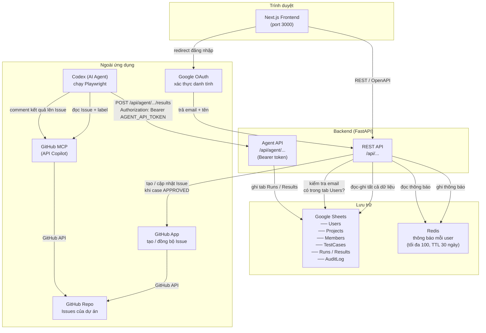
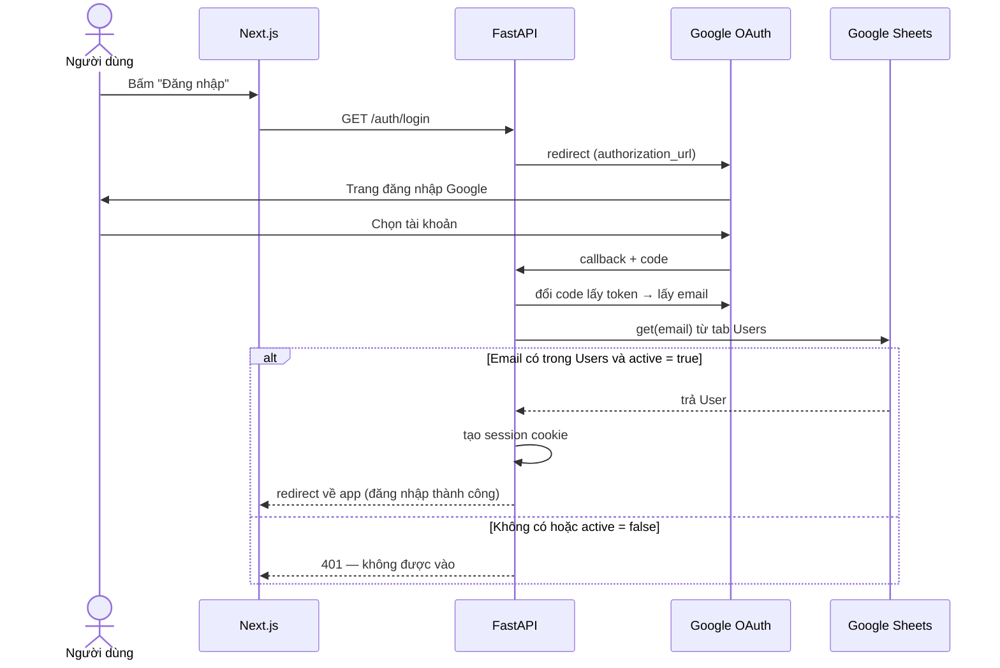
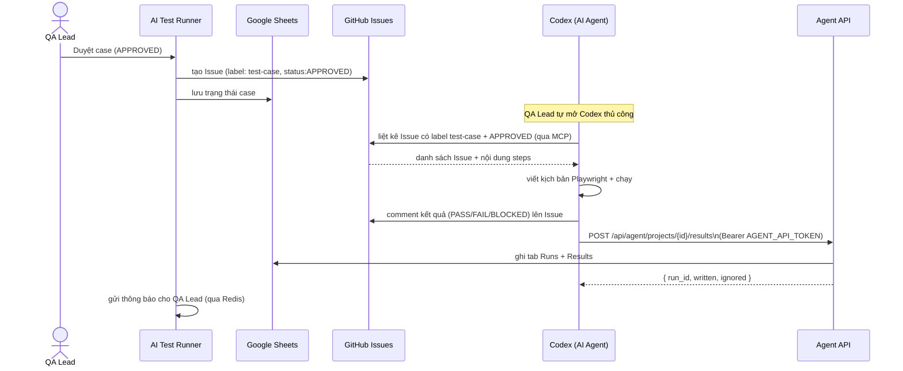

# Kiến trúc hệ thống AI Test Runner

## 1. Tổng quan — dữ liệu chạy ở đâu

> **Dữ liệu chính sống trong Google Sheets.** Redis chỉ giữ thông báo tạm thời — mất thông báo không mất dữ liệu. Codex chạy hoàn toàn ngoài app; nó liên lạc ngược lại qua một API riêng có token.

---

## 2. Luồng đăng nhập (Google OAuth)

> **Hai lớp kiểm soát:** Google xác nhận danh tính; app kiểm tra email có trong tab Users không. Nếu app đang ở chế độ "Testing" trên Google Cloud, Gmail còn phải được thêm vào danh sách Test users ở Google Cloud Console.

---

## 3. Luồng Codex chạy test case

> **Codex không tự khởi động.** QA Lead mở Codex và paste prompt mẫu từ `docs/codex-agent.md`. Codex đọc Issue qua GitHub MCP, chạy Playwright thật, rồi báo kết quả cả lên Issue lẫn vào API.

---

## Bản đồ thư mục nhanh

| Thư mục / file | Làm gì |
|---|---|
| `backend/app/api/routers/` | Các endpoint REST (auth, projects, test_cases, notifications, agent, results, …) |
| `backend/app/core/services/` | Logic nghiệp vụ (không biết HTTP) |
| `backend/app/core/repositories/` | Đọc-ghi Google Sheets |
| `backend/app/core/sheets/gateway.py` | Cổng duy nhất gọi Google API |
| `backend/app/core/notifications.py` | Lưu/đọc thông báo trong Redis |
| `backend/app/core/github/` | Tạo/đồng bộ GitHub Issue |
| `frontend/` | Next.js — giao diện người dùng |
| `docs/codex-agent.md` | Hướng dẫn cấu hình và dùng Codex |
